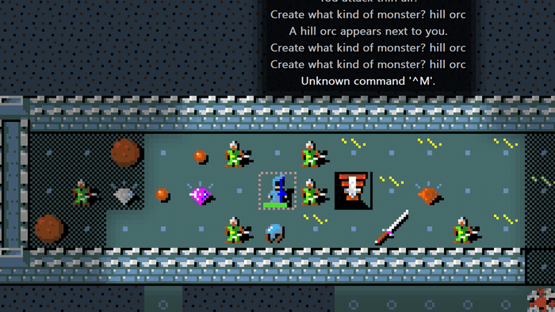
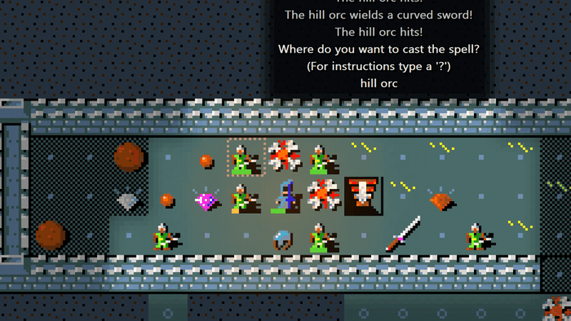
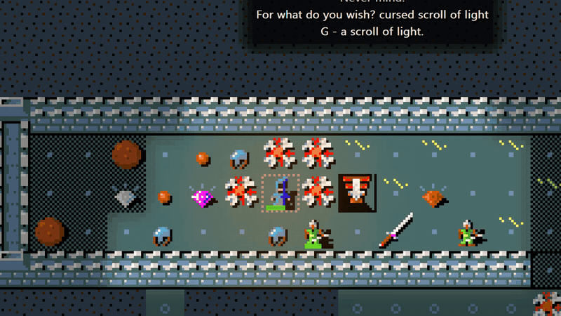
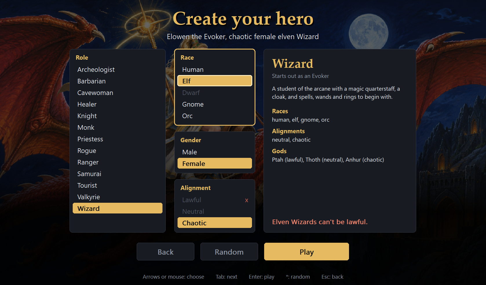
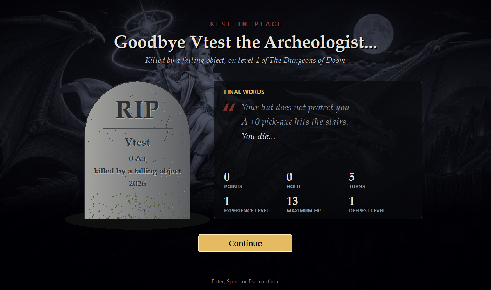
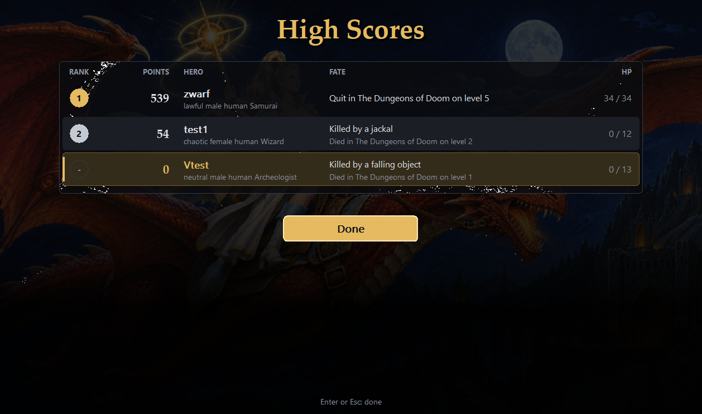

# NetHack Modern


NetHack Modern is a fork of **NetHack 5.0** that changes how the game
looks and sounds, on Windows and Linux. It adds a dark interface,
floating damage numbers, health bars, animations, particle effects,
lighting, and a full set of sound effects and level ambience. **The game
itself is unchanged.** Every rule, monster, item and random roll is
vanilla NetHack 5.0, and your saves are ordinary 5.0 saves.

It comes in two windows that look and play alike:

- **The SDL window** (`NetHackSDL.exe` on Windows, the AppImage on
  Linux), a new front end that draws with the GPU.
- **NetHackW** (`NetHackW.exe`, Windows only), NetHack's own Windows
  tiles interface, restyled.

Each addition has its own option, so you can turn off any of them and get
back the look of stock NetHack.

**Not a variant, but not stock NetHack either.** NetHack Modern changes
NetHack's source code: it adds small hooks that tell the interface what
just happened (a hit, a miss, a spell, a death). Those hooks only
report; they don't change any rules. So it isn't a variant in the sense
of SLASH'EM or EvilHack, which play differently. Think of it as NetHack
5.0 with a new coat of paint.

**Not an official release.** NetHack Modern is not an official NetHack
release and is not affiliated with or endorsed by the NetHack DevTeam.
Please report problems with it here, not to the DevTeam.

> The NetHack DevTeam's own README, which covers NetHack 5.0 itself, is

> still in this repository as [`README`](README).

---

## Contents

- [Status and plans](#status-and-plans)
- [What stays the same](#what-stays-the-same)
- [What's new](#whats-new)
- [Playing](#playing)
- [Options](#options)
- [Building from source](#building-from-source)
- [How it works](#how-it-works)
- [Changes to NetHack's own files](#changes-to-nethacks-own-files)
- [Credits and licences](#credits-and-licences)

---

## Status and plans

NetHack Modern is a work in progress. It changes as it goes: features
get adjusted, rough edges get fixed and new ideas get added along the
way, so expect each release to look and sound a little different from
the last.

**Done so far:** the event stream, damage numbers and health bars,
status text, sound, animation, lasting status effects, the interface,
level ambience, lighting, tilesets and pointing projectiles; the **SDL
window**, which draws all of it with the GPU, on Windows and Linux; and
a **Linux AppImage** with sound.

**Still to do:**

- Fix the rough edges found in play.
- **More platforms.** The SDL window is the way to macOS and Linux on
  ARM; neither is built yet.
- Bring the SDL window up to NetHackW where it's behind: NetHackW still
  has the tileset picker and ASCII map modes.
- **Try the updater on a real release.** The title screen says when a
  new release is out (`fx_check_updates`), and Update and restart
  downloads it, checks its signature and installs it (the Windows zip
  install and the Linux AppImage); it has only met test releases so far.

[`docs/modern/ROADMAP.md`](docs/modern/ROADMAP.md) has the full history
and design notes.

**Feedback is very welcome.** If something looks wrong, plays badly,
feels slow, or you have an idea for what to add next, please open a
GitHub issue. I appreciate every bug report and suggestion.

Contributions as pull requests are welcome too. I'll do my best to pick
what fits this modern take on NetHack: changes that make it look, sound
and feel better while the game underneath stays vanilla.

---

## What stays the same

- **The rules.** Nothing NetHack Modern adds changes game state or uses
  the random number generator. A game plays out exactly as it would in
  NetHack 5.0.
- **Saves.** The save format is unchanged. The one extra flag, which
  tells magical sleep apart from paralysis so the right effect shows,
  uses a bit the save file already had spare.
- **What you know.** Effects only show what the hero can already see or
  sense. A monster's hidden speed, a disguised mimic or an unseen
  summoning get no effect. Messages you've hidden with `MSGTYPE` make no
  sound.
- **Your config file.** Your `.nethackrc` is never written to. Settings
  you change while playing go into a separate file (see
  [Remembered settings](#remembered-settings)).
- **Speed.** Animations never hold up input. A keypress finishes any
  running animation at once. Running, travel and count-prefixed commands
  skip the per-step animation, and damage is added up into one number.
  When nothing is moving, the map redraws just as stock NetHack does.
- **Other interfaces.** The tty, curses and other ports build and play as
  before. All the visual work is in the SDL window and NetHackW. The
  console `NetHack.exe` is stock; in the Linux build the terminal game
  looks stock but plays the new sounds.

## What's new

### Combat feedback

- **Damage numbers.** Damage and healing float up from whoever took it,
  for the hero and for every monster in sight. They're coloured by kind:
  physical white, fire orange, cold blue, poison green, healing bright
  green. Big hits show larger.
- **Health bars.** A thin bar under every damaged creature you can see.
- **Status text.** When a status lands on someone, its name floats up:
  "Confused", "Stunned", "Blinded", "Fast", "Slowed", "Stoning" and so
  on. Bad ones are red or purple, good ones gold or green. Also "Miss",
  "Killed" and "Died", "Level N!" in gold, and "+N XP".



### Animation

- **Lunges.** Attackers nudge toward their target and back.
- **Hit shakes.** The victim shakes and recoils away from the blow, more
  for bigger hits.
- **Deaths.** The body shakes and then fades out.
- **Knockback** slides the target to its new square.
- **Screen shake** for explosions, earthquakes and big hits.
- **Smooth movement.** Creatures glide from one square to the next
  instead of jumping. The glide gets shorter when you move fast, so the
  screen keeps up with your keypresses.
- **Pointing projectiles.** Arrows, bolts, daggers, darts, spears and the
  like turn to point the way they fly, whoever throws or fires them. The
  direction is measured from the tile picture itself, so this works with
  any tileset. Round things such as rocks are left alone.

### Particle effects

Rays and breath attacks, explosions, every wand, potions, scrolls,
teleports, detection, the unicorn horn and more get particle effects. A
monster that is summoned or created in sight arrives with a spiral, a
flash and a ring, coloured by where it came from: violet for create
monster, fire and smoke for demons, gold for angels, a dusty burst for
insects and snakes. Gas clouds billow.

Every spell has a look and a sound. Casting draws motes of the spell
school's colour into your hands. A spell that works like a wand, scroll
or potion then plays that item's effect. The rest have their own: a
golden haze for protection, a sweep of sight for clairvoyance, dust where
you jump and land, and crackling sparks for chain lightning.



### Lasting status effects (auras)

While a status lasts, it shows on the creature, even when it's standing
still:

| Status | Look |
|---|---|
| Very fast | a trailing afterimage of the sprite |
| Asleep (magical) | rising z's |
| Stunned / confused | orbiting stars / swirls |
| Slowed | sinking drops |
| Levitating | air moving under the sprite |
| Reflecting | an occasional glint |
| Protection spell | a soft ring |
| Stoning / slimed / sick | grit, slime or bubbles |
| Invisible but seen | a see-through sprite |
| Conflict (you) | dark red rings pulsing outward |
| In your Conflict's reach | a throbbing red glow and rising embers |

Auras run on their own slow timer, which only runs while one is in view.

### Lighting

A smooth shade layer lies over the map. Lit rooms are fully bright. Light
from lamps, candles and glowing monsters fades toward the edge of its
reach, with a warm tint. Candles, oil lamps and fire creatures flicker;
lanterns and glowing weapons stay steady. Remembered squares are dimmed
and solid rock stays dark. How dark out-of-sight areas get can be set to
light, medium, dark or deep.



### Interface

Both windows share this look; the few differences are noted.

- **Dark theme.** One dark palette, clean fonts, a dark title bar and
  flat panels in place of the sunken Win32 look.
- **Menu bar by topic:** Game, View, Items, Gear, Act, Magic, Info,
  Help (NetHackW adds Move). Each entry shows its key, so the menus also
  teach the keys.
- **Character panel.** Title, HP and Pw as coloured bars, a stat grid
  with up and down arrows when a stat changes, your conditions, and an
  equipment doll showing the tiles of what you wear and wield. On a
  narrow window the parts give way in turn, but the dungeon level always
  shows.
- **Action buttons.** Buttons for what makes sense right now, such as Go
  up, Search or Rest, each with its key, floating just above the panel.
- **Messages on the map.** The latest messages float over a corner of the
  map with an outline that reads over any floor. Older turns fade and
  then drop away. Important ones are coloured (traps, "You see here",
  `MSGTYPE` and `menucolors` matches). You can put them in any corner or
  at the middle of the top or bottom edge, and add a translucent panel
  behind them. Ctrl+P still scrolls back through the history.
- **Map zoom.** The whole level fits the window by default. Ctrl+= and
  Ctrl+- zoom, Ctrl+0 resets, and Ctrl+mouse wheel works too.
- **Hero frame.** Gold corner marks around the hero's square, which slide
  along as the hero moves.
- **Inventory panel.** Grouped by item class with headers, each line with
  the item's tile. It updates as your inventory changes and has a Hide
  button.
- **Clearer menus.**
- **Title screen.** The game opens on a title screen inside the window,
  with Play, About and Exit and both version numbers. Dying, quitting or
  saving brings you back to it, ready for another game; closing the
  window still exits.
- **Character creation.** The name prompt and the role, race, gender and
  alignment choices are full-window screens in the same style as the
  title screen, in place of the old pop-up dialogs. Use the mouse or the
  keyboard: arrows move between and through the lists, Tab steps through
  everything, letters jump to a role, `*` picks at random, Enter plays
  and Esc goes back. The game's rules about what goes together still
  apply. Choices that don't fit are dimmed, pointing at one says why, and
  changing your role or race moves any later choice that no longer fits.
  A side panel describes the role, its races, alignments and gods.



- **Saved heroes.** If you have saved games, Play leads to a **Choose
  your hero** screen first: a card for each, with the hero's tile (the
  race's creature if you use `showrace`), name, alignment, race and role,
  and an Explore or Wizard badge if it was played that way. Continue
  (or double-click a card), start a New hero, or Delete one after a
  "Delete ... for good?" check. Many saves scroll. With none, Play goes
  straight to the name screen.

- **Death screen and high scores.** When your hero dies, a full-window
  screen takes the place of the old tombstone pop-up. It shows a
  weathered gravestone, your final words (the messages of your last
  turn) and how far you got: points, gold, turns, experience level,
  maximum HP and deepest level. The score list after it is a table, with
  medals for the top three and your own entry picked out in gold. Each
  entry gives the hero, cause of death and place. Scroll it with the
  wheel or the arrow keys.





### The SDL window

The SDL window draws everything above with the GPU, so scaling, blending
and lighting stay smooth at any size. It runs on Windows and Linux, and
adds a few things of its own:

- **Fonts of your choice.** View > Fonts... (or `#fonts`) opens a window
  of drop-downs: a font and a style (regular, bold, italic) for the
  text, the messages on the map, the floating numbers, and the title,
  character and end screens, each with a sample line. The text's list
  holds only monospace fonts, so its columns line up. Real bold and
  italic font files are used where the font has them.
- **Conditions on the map.** Burdened, Hungry, Confused and the rest show
  as chips on the map rather than at the panel's end, where a narrow
  window would push them out of sight. By default they're a row at the
  top left; the View menu moves them to any corner (or back into the
  panel) and switches between a row and a column. They step round the
  action buttons, and messages move aside only if they'd overlap.
- **Text and window size.** Alt+= and Alt+- make the text larger or
  smaller; the window remembers its size. Both are options too.

### Tilesets

In NetHackW, the View menu can switch between the built-in tiles and any
tile image laid out like NetHack 5.0's own `tiles.bmp`. The tile size is worked out
from the image, and zoom keeps tiles at a sensible size on screen, so
large tiles fit the whole level and show their detail when you zoom in.
No third-party tileset ships with NetHack Modern. Older tilesets made for
the 3.6 layout need converting to the 5.0 layout first.

### Sound

NetHack Modern adds a new sound library built on
[miniaudio](https://miniaud.io/), which can play many sounds at once,
unlike the basic Windows `PlaySound` backend, and works on Linux too. It
has about 700 samples:

- weapon sounds for each weapon skill, with elemental layers for fire,
  cold and shock;
- misses, critical hits, and a death cry for each kind of creature;
- spells, wands, potions, scrolls, prayer, traps, doors and locks;
- eating, matched to what you're eating;
- level-up and other rewards;
- wading (there are no other footsteps, on purpose).

It also plays the sound effects the core already asks for.

**Level ambience** plays a quiet loop for each kind of level and
crossfades when you change levels, with an occasional sound on top.
There are loops for the Gnomish Mines, Minetown, Sokoban, the Oracle, the
quest, Fort Ludios, Medusa's island, the Castle, the Valley, Gehennom's
fire, ice, water and barred levels, Vlad's Tower, the Wizard's Tower,
the Planes and more. Effects and ambience have separate volume controls,
in the Game menu and as options.

**Menu music.** A wistful medieval lament plays on the title, name and
character screens and fades out once play begins. The speaker icon in the
top right corner (or Ctrl+M) turns it off and on, and that choice is
remembered.

**Death tune.** When your hero dies, a distant church bell tolls slowly over
a low drone and a cold wind. Turn it off with the `fx_death_music` option.

## Playing

Download the release for your system from the releases page.

**Windows:** unpack the zip anywhere and run **`NetHackSDL.exe`** (the
SDL window) or **`NetHackW.exe`** (NetHackW). Both use the same saves
and settings, so you can switch between them. Keep everything else in
the folder next to the exe: the `sounds` folder, the SDL DLLs, and
`tiles.bmp` and `splash_art.png`, which the SDL window reads.

**Linux:** make the AppImage executable and run it:

```
chmod +x NetHackModern-v*-x86_64.AppImage
./NetHackModern-v*-x86_64.AppImage
```

It opens the SDL window. Saves, scores and the `sysconf` file live in
`~/.local/share/nethackmodern` (set `NETHACKMODERN_DIR` to use another
folder). Your config file is `~/.nethackrc` as usual. With no desktop to
open a window on, it falls back to the terminal game.

Everything else plays like NetHack. The [NetHack Guidebook](doc/) and
the in-game help (`?`) cover the game itself.

### Keys

| Key | What it does |
|---|---|
| Ctrl+= or Ctrl+numpad + | zoom the map in |
| Ctrl+- or Ctrl+numpad - | zoom the map out |
| Ctrl+mouse wheel | zoom in or out |
| Ctrl+0 | back to the default zoom, which fits the whole level |
| Ctrl+P | scroll back through earlier messages |
| Ctrl+M | menu music off or on (title and creation screens) |
| Alt+= / Alt+- | larger or smaller text (SDL window) |
| `#fonts` | choose fonts (SDL window; also View > Fonts...) |

Every other key is NetHack's own. The menu bar lists each command with
its key, so it doubles as a key reference.

### Remembered settings

Any `fx_` option you change while playing, from the menu bar or the
full options menu (`m O`), is saved to **`nethackmodern.rc`**. It sits
beside your own NetHack config file (on Windows normally in
`%USERPROFILE%\NetHack\`; on Linux in your home folder, beside
`.nethackrc`) and is read after it. Your own config file is never
touched. To go back to your own settings, delete a line from that file,
or the whole file.

You can also set any of the options below in your own config file as
usual, for example `OPTIONS=!fx_screen_shake,fx_shade:dark`.

## Options

Every addition has an option, under `fx_` names in the full options list
(`m O`). Most are also in the View and Game menus.

| Option | Default | What it does |
|---|---|---|
| `fx_damage_numbers` | on | floating damage and healing numbers |
| `fx_healthbars` | on | health bars under creatures |
| `fx_status_text` | on | status names floating up as they land |
| `fx_exp_text` | on | "+N XP" floaters |
| `fx_motion` | on | lunges, shakes, death fades, smooth movement |
| `fx_screen_shake` | on | the view shakes for explosions and big hits |
| `fx_particles` | on | rays, explosions, wand, potion and scroll effects |
| `fx_auras` | on | lasting status effects on creatures, gas clouds |
| `fx_afterimage` | on | speed afterimages |
| `fx_turn_missiles` | on | thrown and fired things point the way they fly |
| `fx_theme` | on | dark theme, fonts, panels and menu bar (restart to apply) |
| `fx_msg_overlay` | on | messages on the map instead of a strip (restart to apply) |
| `fx_msg_backdrop` | off | a translucent panel behind those messages |
| `fx_msg_pos` | bottom-left | message corner: top or bottom; left, centre or right |
| `fx_hero_frame` | on | gold corner marks around the hero |
| `fx_hero_frame_light` | off | a lighter version of the hero frame |
| `fx_lighting` | on | soft light on the map; out-of-sight squares dimmed |
| `fx_shade` | medium | how dark out of sight gets: light, medium, dark, deep |
| `fx_bar_style` | flat | HP/Pw bars: flat, smooth, gloss, striped, bevel |
| `fx_bar_border` | off | a thin dark outline around the HP/Pw bars |
| `fx_ambience` | on | level ambience loops |
| `fx_volume` | 100 | sound effects volume, 0–100 |
| `fx_ambience_volume` | 60 | ambience volume, 0–100 |
| `fx_menu_music` | on | music on the title and character creation screens |
| `fx_death_music` | on | a mournful tune when your hero dies |
| `fx_hide_inventory` | off | keep the inventory side panel hidden |
| `fx_action_buttons` | on | buttons for what can be done here, above the panel |
| `fx_check_updates` | on | look for a newer NetHack Modern once a day, on the title screen (Help > Check for updates works either way) |

These are for the SDL window only:

| Option | Default | What it does |
|---|---|---|
| `fx_map_zoom` | auto | map square size in pixels; auto fits the whole level |
| `fx_text_size` | auto | text size in pixels; auto suits the screen |
| `fx_window_size` | auto | window size as WIDTHxHEIGHT |
| `fx_font_text` | auto | font for menus, status and the messages list (monospace) |
| `fx_font_message` | auto | font for messages on the map |
| `fx_font_float` | auto | font for floating numbers on the map |
| `fx_font_title` | auto | font for the screens' headings |
| `fx_font_screen` | auto | font for the rest of those screens |
| `fx_cond_pos` | top-left | where conditions show: top-left, bottom-left, top-right, bottom-right, panel |
| `fx_cond_layout` | row | conditions in a row or a column |

A font option takes a font's name, then `bold`, `italic` or
`bold italic` if wanted, for example
`OPTIONS=fx_font_message:Segoe UI italic`; or a font file; or `auto`
for the window's own.

The tileset is NetHack's own `tile_file` option (`tile_file:none` means
the built-in tiles; NetHackW only).

## Building from source

### Windows

You need **Visual Studio 2022** with the "Desktop development with C++"
workload.

1. Open `sys\windows\vs\NetHack.sln`, or build from a Developer Command
   Prompt:

   ```
   cd sys\windows\vs
   msbuild NetHack.sln -m -p:Configuration=Release -p:Platform=x64
   ```

2. The build fetches PDCursesMod and the prebuilt SDL3 and SDL3_ttf
   packages into `lib\` the first time (the `fetchprereq` project).

3. The `package` project gathers the game into `vsbinary\`:
   `NetHackSDL.exe` (the SDL window) with its DLLs, `tiles.bmp` and
   `splash_art.png`, `NetHackW.exe` (NetHackW), `NetHack.exe` (console),
   the game data and the `sounds` folder:

   ```
   msbuild NetHack.sln -t:package -p:Configuration=Release -p:Platform=x64
   ```

   It also makes the release zip,
   `vspackage\NetHackModern-v<version>-windows-x64.zip`, named for the
   version in `include\fx.h` (`MODERN_VERSION_STRING`), with everything
   under a `NethackModernW` folder
   (`sys\windows\vs\package\make-release-zip.ps1`).

4. Close the game before rebuilding, or the linker can't replace the exe.

### Linux

The SDL window needs SDL3 and SDL3_ttf 3.x;
`sys/unix/appimage/build-sdl3.sh` builds them from source if your
distribution doesn't have them. Then, from the top of the tree:

```
sh sys/unix/setup.sh sys/unix/hints/linux.501
make WANT_WIN_TTY=1 WANT_WIN_CURSES=1 WANT_WIN_SDL=1 WANT_DEFAULT=sdl \
     WANT_MINIAUDIO=1 install
```

(Set `PKG_CONFIG_PATH` if SDL3 isn't installed system-wide.) The CI
workflow `.github/workflows/modern-linux.yml` builds the AppImage the
same way, with `sys/unix/appimage/build-appimage.sh`.

### Signed releases

The game's updater installs only downloads signed with the release key
(minisign, Ed25519), and only the file the signature names. The public
key is `sys/share/nethackmodern.pub`; the password-protected secret key
stays off the repository. Each release has these four files:

| File | Made by |
|---|---|
| `NetHackModern-v<version>-windows-x64.zip` | the `package` build |
| `NetHackModern-v<version>-windows-x64.zip.minisig` | `sys\windows\vs\package\sign-release.ps1` (asks for the password) |
| `NetHackModern-v<version>-x86_64.AppImage` | `modern-linux`, on the version tag |
| `NetHackModern-v<version>-x86_64.AppImage.minisig` | `modern-linux`, with the `MINISIGN_KEY` and `MINISIGN_PASSWORD` secrets |

Pushing a version tag makes a draft release with the AppImage and its
signature attached; add the zip, its signature and the notes, then
publish.

### Testing

For testing, `scripts\wizard.cmd` starts the build in wizard (debug) mode
as the player "wizard". It also writes every presentation event to
`vsbinary\fxlog.txt`. Wizard mode needs `WIZARDS=*` (or your user name) in
the sysconf file, normally `C:\ProgramData\NetHack\5.0\sysconf`.

Setting the environment variable `NETHACK_FXLOG=<file>` logs the same
events with any interface.

The SDL window can be driven without a screen, for automated checks:
`SDL_VIDEO_DRIVER=offscreen`, with `NETHACK_SDL_KEYS` typing keys in at
the start and `NETHACK_SDL_SHOT=<file.png>` saving each frame drawn.
`NETHACK_SDL_TEST_CONDS` shows a few sample conditions. Run such tests
in a game folder of their own, not your real one.

## How it works

The game core doesn't know about pixels. NetHack Modern adds one small
module, **`src/fx.c`**, which the core calls at interesting moments, and
which passes **presentation events** to whatever front end has signed up
for them:

```
fx_damage(x, y, amount, kind, who)
fx_miss(x, y, who)
fx_death(x, y, mon)
fx_attack(from_x, from_y, to_x, to_y, attack_type)
fx_spell(x, y, spell_or_zap_type)
...
```

- **Damage isn't hooked at all ~140 places that change HP.** Instead
  `fx_sync()` runs whenever the screen is flushed and compares each
  creature's HP and status with what it saw last time. The numbers and
  status names therefore appear together with the message they belong
  to. Explicit hooks only add what a comparison can't know: who attacked
  whom, misses, deaths and the kind of damage.
- **Lasting statuses are state, not events.** Each map square already
  reaches the front end as a `glyph_info`. NetHack Modern adds a bitmask
  to it, `fxauras`, which is worked out from real game state each time
  the square is drawn. Nothing new is saved, and front ends that ignore
  it draw exactly what they did before.
- **Events are pure output.** They never use the random number
  generator, never change the game and are never saved. They're only
  sent for things the hero can perceive.
- **Two listeners.** The display listener (`fx_set_handler`) is the
  NetHackW map or the SDL window. The sound listener
  (`fx_set_audio_handler`) is the miniaudio sound library. A front end
  that registers no display listener draws nothing new, so tty and
  curses look as they always did.
- **Shared drawing logic.** Both windows draw the same effects from one
  shared module, `win/share/fxview.c`: particles, floating text, motion,
  auras, lighting, the panel's parts, and the title, character, saved
  heroes and end screens' rules, wording and layout. Each window only
  supplies its own way of drawing a box, a tile or a line of text.

### Where the code is

| Path | What's there |
|---|---|
| `src/fx.c`, `include/fx.h` | the presentation event stream |
| `sound/miniaudio/` | the miniaudio sound library (`masound.c`) |
| `sound/modern/` | sound samples, ambience loops and `attributions.txt` |
| `win/share/fxview.c`, `fxview.h` | effects and screen logic shared by both windows |
| `win/sdl/sdlmain.c` | the SDL window |
| `win/win32/` | the NetHackW port: map effects and lighting (`mhmap.c`), character panel (`mhstatus.c`), messages (`mhmsgwnd.c`), menus (`mhmenu.c`), menu bar and window (`mhmain.c`), title screen (`mhsplash.c`), name, character and saved heroes screens (`mhcharsel.c`), end screens (`mhend.c`), theme colours (`mhtheme.h`) |
| `sys/windows/vs/NetHackSDL/` | the Visual Studio project for `NetHackSDL.exe` |
| `sys/unix/appimage/` | building SDL3 and the Linux AppImage |
| `docs/modern/ROADMAP.md` | design notes, phases and the full options table |
| `MODERN.md` | notes for developers: remotes, merging upstream, where code goes |

## Changes to NetHack's own files

NetHack Modern keeps its edits to DevTeam files small, usually one
`fx_*()` call at each hook site, so DevTeam fixes merge in cleanly
(`git fetch upstream && git merge upstream/NetHack-5.0`). Apart from the
new files above, it changes:

- **Hook calls** in the combat, zapping, throwing, explosion, potion,
  scroll, teleport and death code (`uhitm.c`, `mhitu.c`, `mhitm.c`,
  `zap.c`, `explode.c`, `dothrow.c`, `mthrowu.c`, `mon.c` and others).
  These only report what happened.
- **`display.c`**: fills in the `fxauras` mask, and tells the front end
  where a thrown or fired object is in flight so it can be pointed.
- **`include/wintype.h`**: the `fxauras` field in `glyph_info`.
- **`include/monst.h`**: the `mfxslept` flag, in a spare bit.
- **`include/seffects.h`**: extra sound effect names.
- **`include/optlist.h`, `include/flag.h`, `src/options.c`**: the `fx_`
  options, and `tile_file:none`.
- **`src/cfgfiles.c`**: writing remembered settings to
  `nethackmodern.rc`.
- **`src/windows.c`, `include/config.h`, `include/global.h`**: the SDL
  window as a choice of interface, with tiles.
- **`src/cmd.c`**: the `#fonts` command.
- **`sys/windows/windmain.c`**: starting `NetHackSDL.exe` with no
  console and the SDL window only.
- **`sys/unix/hints/`** and **`sys/unix/unixmain.c`**: building the SDL
  window and the sound library on Linux.
- **`win/win32/`** and the Visual Studio project files: the restyled
  port, `NetHackSDL.exe`, and the new sound library.

## Credits and licences

- **NetHack** is by the NetHack DevTeam and is released under the
  [NetHack General Public License](dat/license). NetHack Modern is
  released under the same licence.
- **Sounds:** every file is credited in
  [`sound/modern/attributions.txt`](sound/modern/attributions.txt),
  which also ships in the release's `sounds` folder. They come from:
  - Kenney (RPG Audio, Impact Sounds), rubberduck and Qvantor (Success,
    Level Up and Reward Sounds), CC0;
  - Leonardo Calvo / Soundrack (Swords & Blades, Archery),
    [CC BY 4.0](https://creativecommons.org/licenses/by/4.0/);
  - AHTu20 (Animals & Creatures), TomMusic (Free Fantasy SFX Pack, also
    the ambience loops) and moneywithjj (Medieval Weapons), royalty-free
    for games.

  The royalty-free packs are included only as part of this game. Don't
  extract them and redistribute them as sound packs.
- **miniaudio** by David Reid, public domain or MIT No Attribution.
- **SDL3** and **SDL3_ttf** by Sam Lantinga and the SDL contributors,
  under the zlib licence (SDL3_ttf includes FreeType and HarfBuzz).
- **DejaVu fonts**, shipped in the Linux AppImage, under the DejaVu
  (Bitstream Vera) licence, which is included beside them.
- **Splash art:** see
  [`win/win32/ART-CREDITS.txt`](win/win32/ART-CREDITS.txt).
